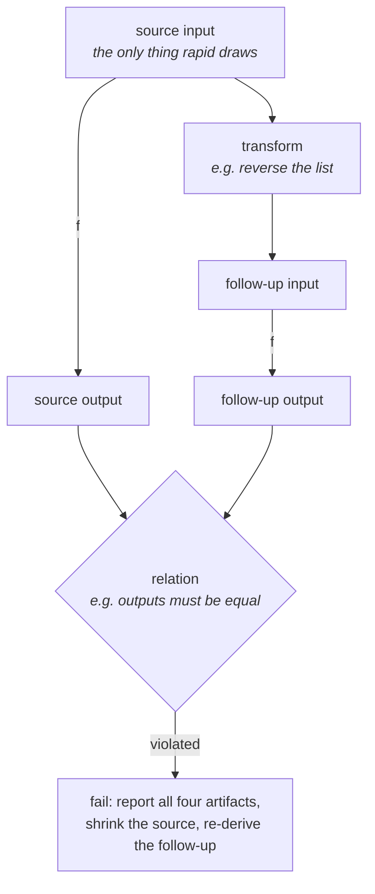

# molt

Metamorphic testing for Go, built on [rapid](https://pgregory.net/rapid) — test relations between runs when you can't know the right answer.

```
go get github.com/tsdkv/molt
```

## Why

A normal test needs an *oracle*: the known-correct output for a given input. For complex data structures, encoders, queries, or numerical code, the correct output is exactly what you don't have.

Metamorphic testing sidesteps the oracle. Instead of checking one run against an expected answer, you run the program **twice on related inputs** and check that the outputs relate in a known way. You don't need to know what `sin(1.234)` is to know that `sin(x)` must equal `sin(π − x)`. You don't need to know the correct sorting of 10,000 random integers to know that sorting a list and sorting its reverse must agree.

Each such rule is a **metamorphic relation**: an input *transformation* ("reverse the list") paired with a *relation* over the two outputs ("they are equal"). A single relation is weak; a handful of them, run over thousands of generated inputs, catch real bugs — including bugs no example-based test would ever specify.



Because all inputs are drawn through [rapid](https://pgregory.net/rapid), failures are reproducible from a seed and automatically minimized to the smallest counterexample.

## Quick start: `molt.Test`

State relations as data — a name, a transform, a check — and `Test` runs each one as its own subtest with its own rapid session:

```go
func TestSort(t *testing.T) {
	molt.Test(t, rapid.SliceOf(rapid.Int()), mysort,

		// built-in transform + built-in relation
		molt.Rel("reverse-invariant", xf.Reverse[int](), molt.EqualFunc[[]int](slices.Equal)),

		// a drawing transform: the extra randomness is declared as a generator
		molt.Rel("append-grows-len", xf.AppendRandom(rapid.Int()),
			func(srcOut, fupOut []int) error {
				if len(fupOut) != len(srcOut)+1 {
					return fmt.Errorf("len = %d, want %d", len(fupOut), len(srcOut)+1)
				}
				return nil
			}),

		// full access to all four artifacts + a precondition
		molt.RelCase("output-is-permutation-of-input", molt.Identity[[]int](),
			func(c molt.Case[[]int, []int]) error { ... }).
			When(func(in []int) bool { return len(in) > 0 }),
	)
}
```

No `rapid.Check` wrapper, no explicit type parameters beyond the odd one, no `*rapid.T` in your transforms. On failure you get the relation as a subtest, all four artifacts minimized, and a reproduction line:

```
=== RUN   TestSort/append-grows-len
    [rapid] failed after 3 tests: metamorphic relation "append-grows-len" violated: len = 1, want 2
        source:        []int{0}
        follow-up:     []int{0, 0}
        source out:    []int{0}
        follow-up out: []int{0}
        To reproduce, specify -run="TestSort/append-grows-len" -rapid.failfile="..."
```

`Test` also warns when a `When` precondition filters out most inputs — a vacuous relation is a silent test.

## Transforms: `Tx` and the `xf` package

A transform derives the follow-up input from the source. Three constructors:

```go
molt.Pure(func(in I) I { ... })                 // no randomness
molt.Drawn(gen, func(in I, r R) I { ... })      // declares its randomness as a generator
molt.Func(func(t *rapid.T, in I) I { ... })     // escape hatch: draws directly
```

`Drawn` draws are reproducible and shrinkable like any rapid draw, and show up in failure traces. The draw cannot depend on the input value — normalize inside apply (an index modulo the length); if you need input-dependent draws, use `Func`.

Ready-made transforms live in [`xf`](./xf): `Reverse`, `Shuffle`, `AppendRandom`, `DropRandom`, `Duplicate`, `AddConst`, `Negate`. Apply them to a field of a larger input with `molt.On`:

```go
molt.On(xf.Shuffle[string](),
	func(c config) []string { return c.Tags },
	func(c config, tags []string) config { c.Tags = tags; return c })
```

Compose transforms with `molt.Compose`, or test every combination of orthogonal transforms with `molt.PowerSet` — compositions are where independently-correct transforms interfere:

```go
mrs := molt.PowerSet("sin", molt.ApproxEqual(1e-9),
	molt.Named[float64]{Name: "shift-2pi", Tx: xf.AddConst(2 * math.Pi)},
	molt.Named[float64]{Name: "mirror-pi", Tx: molt.Pure(func(x float64) float64 { return math.Pi - x })},
)
// 3 MRs: "sin [shift-2pi]", "sin [mirror-pi]", "sin [shift-2pi + mirror-pi]"
molt.Test(t, rapid.Float64Range(-100, 100), math.Sin, mrs...)
```

## Relations

A `Relation[O]` judges the two outputs; the built-in pack: `Equal`, `EqualFunc` (e.g. with `slices.Equal`), `ApproxEqual(tol)`, `AtLeast`/`AtMost` (monotonicity), `PermutationOf`, `SetEqual`. Relations compose:

```go
molt.Contra(func(out []int) int { return out[len(out)-1] }, molt.Equal[int]()) // same max
molt.All(rel1, rel2)   // every relation must hold
molt.Any(rel1, rel2)   // at least one must hold — a weaker oracle
```

Checks that need the inputs (round-trips, "output is a permutation of input") are built with `RelCase` and receive the full `Case`.

Multi-input relations (commutativity, transitivity) are ordinary relations over slices of inputs, drawn with `rapid.SliceOfN`:

```go
swap := molt.Pure(func(xs []int) []int { return []int{xs[1], xs[0]} })
molt.Test(t, rapid.SliceOfN(rapid.Int(), 2, 2),
	func(xs []int) int { return op(xs[0], xs[1]) },
	molt.Rel("commutative", swap, molt.Equal[int]()))
```

## Dropping down a level: `molt.Run`

`Test` is a convenience over `Run`, which applies relations inside your own `rapid.Check` body — for free-form tests with several SUTs, mixed draws, or custom control flow:

```go
rapid.Check(t, func(t *rapid.T) {
	molt.Run(t, gen, f, mrs...)
})
```

Only the source input is ever drawn; the follow-up is re-derived on every iteration. That is what keeps rapid's minimization honest: the reported follow-up is always the genuine transform of the reported source, never an independently-shrunk pair that violates the transform's assumptions.

## Fixed inputs: `molt.RunExamples`

The same relations can run over a fixed list of inputs — regression corpora harvested from rapid failures, inputs too structured to generate, known-nasty cases. No rapid involved, just `testing.T`:

```go
func TestSortRegression(t *testing.T) {
	molt.RunExamples(t, [][]int{{}, {1}, {math.MaxInt, 0}}, mysort, sortMRs...)
}
```

Relations using drawing transforms are rejected up front (they have no source of randomness here).

## Differential testing: `molt.Diff`

The other flavor, in the style of [CockroachDB's metamorphic tests](https://www.cockroachlabs.com/blog/metamorphic-testing-the-database/): run the same random operation sequence against several implementations (or configurations) and fail at the first divergence:

```go
rapid.Check(t, func(t *rapid.T) {
	molt.Diff(t,
		[]molt.Impl[KV]{
			{Name: "mine", Open: openMyStore},
			{Name: "model", Open: openMapModel}, // a plain map as the oracle
		},
		[]molt.Op[KV]{
			{Name: "set", Weight: 3, Prepare: func(t *rapid.T) func(KV) any {
				k, v := keyGen.Draw(t, "key"), valGen.Draw(t, "val") // drawn once...
				return func(s KV) any { s.Set(k, v); return nil }    // ...applied to every impl
			}},
			// get, del, ...
		},
		rapid.IntRange(1, 200),
		nil, // result equality; nil = reflect.DeepEqual
	)
})
```

The whole sequence — length, op choices, arguments — is drawn through rapid, so a divergence is minimized to the shortest op sequence that exposes it.

## Ready-made law sets: `laws`

The `laws` subpackage ships relation batteries for contracts Go code re-implements all the time — one line in a plain test, no rapid knowledge needed:

```go
// your codec must round-trip and encode deterministically
laws.Codec(t, docGen, myMarshal, myUnmarshal, func(a, b Doc) bool { return a == b })

// your sort must produce a sorted permutation of the input, order-independent, idempotent
laws.Sortable(t, rapid.SliceOf(rapid.Int()), mysort)

// your comparator must be reflexive, antisymmetric, eq-consistent, transitive
laws.Comparator(t, rapid.Int(), myCmp, func(a, b int) bool { return a == b })

// your set: construction order/dedup invariance + union/intersection algebra
laws.Set(t, rapid.IntRange(0, 100), newMySet, mySetElements, myUnion, myInter)
```

Every law set is verified in molt's own test suite to catch deliberately broken implementations.

## Status

Early; API may still shift. Done: the core vocabulary (`Case`, `MR`, `Tx`, `Relation`), runners (`Test`, `Run`, `RunExamples`, `Diff`), relation and transform combinators (`All`, `Any`, `Contra`, `On`, `Compose`, `PowerSet`), the `xf` transform library, and law sets for codecs, sort functions, comparators, and sets. Planned: more transforms, more law sets, runnable doc examples.

## License

See [LICENSE](LICENSE).
