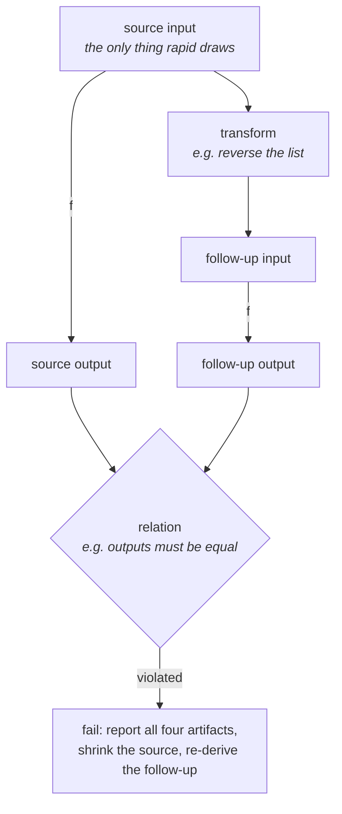
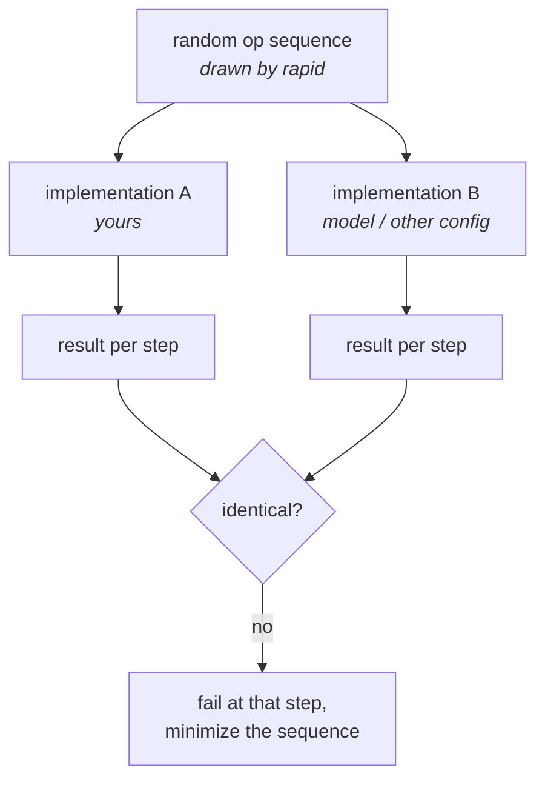

# molt

Metamorphic testing for Go, built on [rapid](https://pgregory.net/rapid) — test relations between runs when you can't know the right answer.

```
go get github.com/tsdkv/molt
```

## Why

A normal test needs an *oracle*: the known-correct output for a given input. For complex data structures, encoders, queries, or numerical code, the correct output is exactly what you don't have.

Metamorphic testing sidesteps the oracle. Instead of checking one run against an expected answer, you run the program **twice on related inputs** and check that the outputs relate in a known way. You don't need to know what `sin(1.234)` is to know that `sin(x)` must equal `sin(π − x)`. You don't need to know the correct sorting of 10,000 random integers to know that sorting a list and sorting its reverse must agree.

Each such rule is a **metamorphic relation**: an input *transformation* ("reverse the list") paired with a *relation* over the two outputs ("they are equal"). A single relation is weak; a handful of them, run over thousands of generated inputs, catch real bugs — including bugs no example-based test would ever specify.



Because all inputs are drawn through [rapid](https://pgregory.net/rapid), failures are reproducible from a seed and automatically minimized to the smallest counterexample.

## Quick start: `molt.Run`

State relations as data — a name, a transform, a check — and `Run` applies all of them to every generated input:

```go
func TestSort(t *testing.T) {
	rapid.Check(t, func(t *rapid.T) {
		molt.Run(t, rapid.SliceOf(rapid.Int()), mysort,
			molt.MR[[]int, []int]{
				Name: "reverse-invariant",
				Transform: func(_ *rapid.T, in []int) []int {
					out := slices.Clone(in)
					slices.Reverse(out)
					return out
				},
				Check: molt.EqualFunc[[]int, []int](slices.Equal),
			},
			molt.MR[[]int, []int]{
				Name: "append-max-extends-output",
				// preconditions are re-checked after every shrink step
				When: func(in []int) bool { return len(in) > 0 && slices.Max(in) < math.MaxInt },
				Transform: func(_ *rapid.T, in []int) []int {
					return append(slices.Clone(in), slices.Max(in)+1)
				},
				Check: func(c molt.Case[[]int, []int]) error {
					if !slices.Equal(c.SourceOut, c.FollowUpOut[:len(c.SourceOut)]) {
						return fmt.Errorf("follow-up output is not the source output extended")
					}
					return nil
				},
			},
		)
	})
}
```

On failure you get the relation name and all four artifacts, with the source input already minimized:

```
metamorphic relation "append-max-extends-output" violated: ...
source:         []int{3, 1}
follow-up:      []int{3, 1, 4}
source out:     []int{1, 3}
follow-up out:  []int{1, 3, 3}
```

`Check` receives a `Case` — source input, follow-up input, and both outputs — so relations can refer to any of them. `Transform` receives the rapid state, so any extra randomness it needs (an inserted element, an offset) is drawn, reproducible, and shrinkable. Never use `math/rand` in a transform.

## Dropping down a level: primitives

`Run` is a convenience over three exported primitives — like rapid, molt is a tiny core with combinators on top. In free-form tests (mixed draws, several SUTs, custom control flow), use them directly:

```go
rapid.Check(t, func(t *rapid.T) {
	src, fup := molt.Follow(t, gen, reverse)       // draw source, derive follow-up
	c := molt.Execute(mysort, src, fup)            // run both, bundle the artifacts
	molt.Assert(t, "reverse-invariant", c, molt.EqualFunc[[]int, []int](slices.Equal))
})
```

Only the source input is ever drawn; the follow-up is re-derived on every iteration. That is what keeps rapid's minimization honest: the reported follow-up is always the genuine transform of the reported source, never an independently-shrunk pair that violates the transform's assumptions.

The whole library is layers, each callable without the ones above:

```
┌──────────────────────────────────────────────────┐
│  mtlaws — ready-made relation sets               │  (planned)
│  for common contracts (codec, comparator, set)   │
├──────────────────────────────────────────────────┤
│  runners      Run · Diff                         │
├──────────────────────────────────────────────────┤
│  combinators  All · Any · Contra                 │
│               Identity · Compose · PowerSet      │
├──────────────────────────────────────────────────┤
│  primitives   Follow · Execute · Assert          │
├──────────────────────────────────────────────────┤
│  rapid        generation · shrinking · seeds     │
└──────────────────────────────────────────────────┘
```

## Composing relations

Relations are values and compose:

```go
// judge a projection of the outputs: "same max", "same length", ...
molt.Contra(func(out []int) int { return out[len(out)-1] }, molt.Equal[[]int, int]())

molt.All(rel1, rel2)   // every relation must hold
molt.Any(rel1, rel2)   // at least one must hold — a weaker oracle
```

The built-in pack: `Equal`, `EqualFunc` (e.g. with `slices.Equal`), `ApproxEqual(tol)` for floats.

## Composing transforms: `PowerSet`

Some relations involve several *orthogonal* transformations that must hold individually **and in every combination** — compositions are where independently-correct transforms interfere. `PowerSet` expands one check and a set of named transforms into an MR per non-empty combination:

```go
mrs := molt.PowerSet("sin", molt.ApproxEqual[float64](1e-9),
	molt.NamedTransform[float64]{Name: "shift-2pi",
		Transform: func(_ *rapid.T, x float64) float64 { return x + 2*math.Pi }},
	molt.NamedTransform[float64]{Name: "mirror-pi",
		Transform: func(_ *rapid.T, x float64) float64 { return math.Pi - x }},
)
// 3 MRs: "sin [shift-2pi]", "sin [mirror-pi]", "sin [shift-2pi + mirror-pi]"

rapid.Check(t, func(t *rapid.T) {
	molt.Run(t, rapid.Float64Range(-100, 100), math.Sin, mrs...)
})
```

Plus `molt.Compose(t1, t2)` and `molt.Identity` for building transforms by hand.

## Differential testing: `molt.Diff`

The other flavor, in the style of [CockroachDB's metamorphic tests](https://www.cockroachlabs.com/blog/metamorphic-testing-the-database/): run the same random operation sequence against several implementations (or configurations) and fail at the first divergence:



```go
rapid.Check(t, func(t *rapid.T) {
	molt.Diff(t,
		[]molt.Impl[KV]{
			{Name: "mine", Open: openMyStore},
			{Name: "model", Open: openMapModel}, // a plain map as the oracle
		},
		[]molt.Op[KV]{
			{Name: "set", Weight: 3, Prepare: func(t *rapid.T) func(KV) any {
				k, v := keyGen.Draw(t, "key"), valGen.Draw(t, "val") // drawn once...
				return func(s KV) any { s.Set(k, v); return nil }    // ...applied to every impl
			}},
			// get, del, ...
		},
		rapid.IntRange(1, 200),
	)
})
```

The whole sequence — length, op choices, arguments — is drawn through rapid, so a divergence is minimized to the shortest op sequence that exposes it.

## Status

Early; API may still shift. Done: the core vocabulary (`Case`, `MR`, `Relation`), both runners (`Run`, `Diff`), primitives (`Follow`, `Execute`, `Assert`), relation and transform combinators. Planned: n-ary relations (commutativity, transitivity — multiple independent source inputs), an example-driven mode, and a catalog of ready-made relation sets for common contracts (codecs, comparators, sets, maps).

## License

See [LICENSE](LICENSE).
